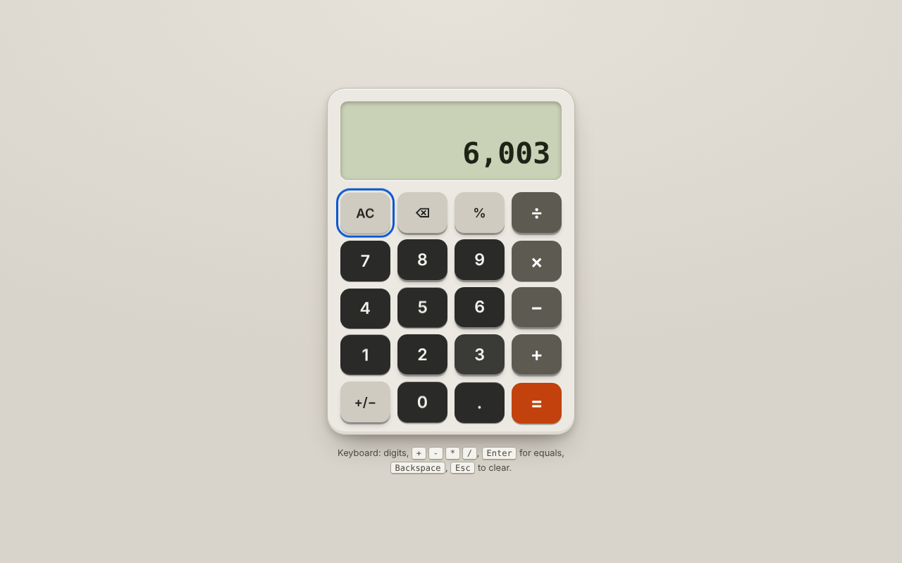
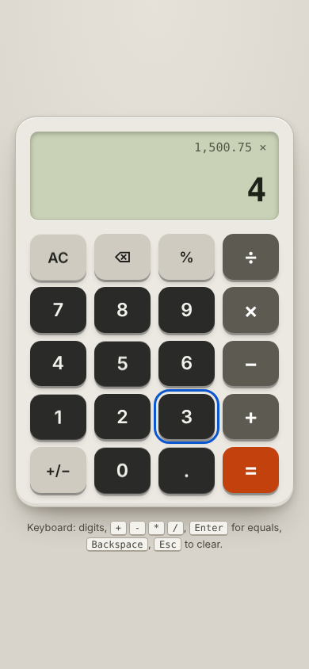

# Calculator

A small, keyboard-friendly calculator built with plain HTML, CSS and JavaScript. No framework, no build step, no `eval()`.

Live demo: https://calculator-eait.vercel.app

| Desktop | Mobile |
| --- | --- |
|  |  |

## Features

- Add, subtract, multiply, divide, percent, change sign, backspace, clear.
- Full keyboard support: digits, `.` (or `,`), `+ - * /` (also `x` for multiply), `Enter` or `=` for equals, `Backspace`, `Esc` / `Delete` / `c` to clear, `%`.
- Decimal precision: `0.1 + 0.2` shows `0.3`, not `0.30000000000000004`. Results are rounded to 12 significant digits.
- Division by zero shows a message instead of `Infinity`; the next key press starts over.
- Thousands separators in the display, and very long numbers shrink or switch to exponent notation so they never overflow.
- The readout is an `<output>` element (a polite live region) so screen readers announce what you type. Visible focus rings on every key, `prefers-reduced-motion` respected.

## Behaviour notes

- It works like a pocket calculator: each operator is applied as soon as the next operator or `=` is pressed, so `2 + 3 x 4 =` gives `20`, not `14`.
- Pressing two operators in a row replaces the first one.
- `%` divides the current number by 100 (it does not do "percent of the previous number").
- Input is capped at 15 digits.

## Run it

It is a static site, so any static server works:

```sh
python3 -m http.server 5252
# open http://localhost:5252
```

## Tests

The arithmetic lives in `engine.js` (pure functions, no DOM) and is covered by Node's built-in test runner, no dependencies:

```sh
node --test
```

13 tests cover floating point precision, operator chaining, divide by zero, input limits and display formatting. A GitHub Actions workflow runs them on every push.

## Files

- `index.html`, `style.css`: markup and styling (system font stacks, no external assets)
- `engine.js`: calculator state machine, usable from the browser and from Node
- `main.js`: DOM wiring and keyboard handling
- `test/engine.test.js`: unit tests

## Verification

Checked in headless Chromium with Playwright: keyboard input, clicking, divide by zero recovery, focus behaviour and no console errors at 1280px and 390px widths. Unit tests were run with Node 22.

## Known limitations

- No repeat-equals (pressing `=` again does not repeat the last operation) and no memory keys.
- Results use rounded floating point, not arbitrary precision decimals, so values beyond about 12 significant digits are rounded.

## Notes

UI and code quality improvements were made with AI assistance (Claude, Anthropic), reviewed and verified by building and running the app.
